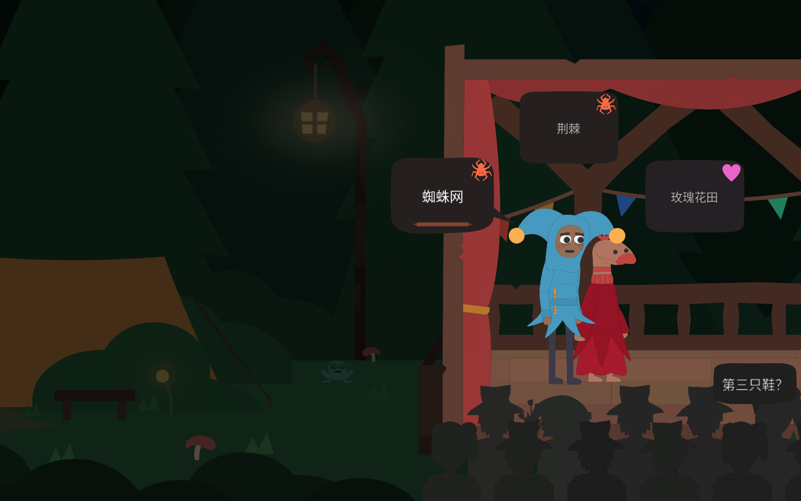
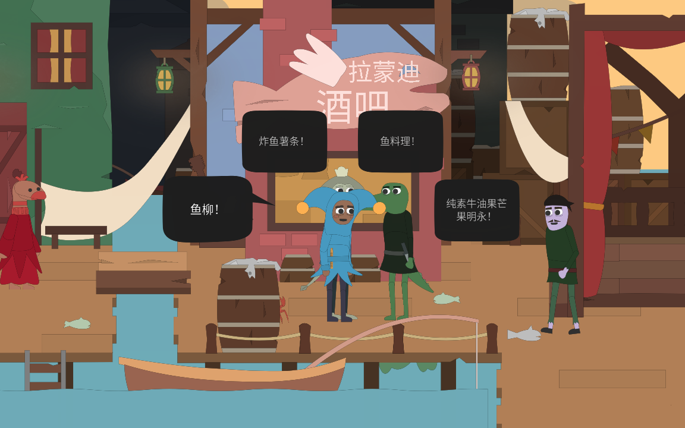
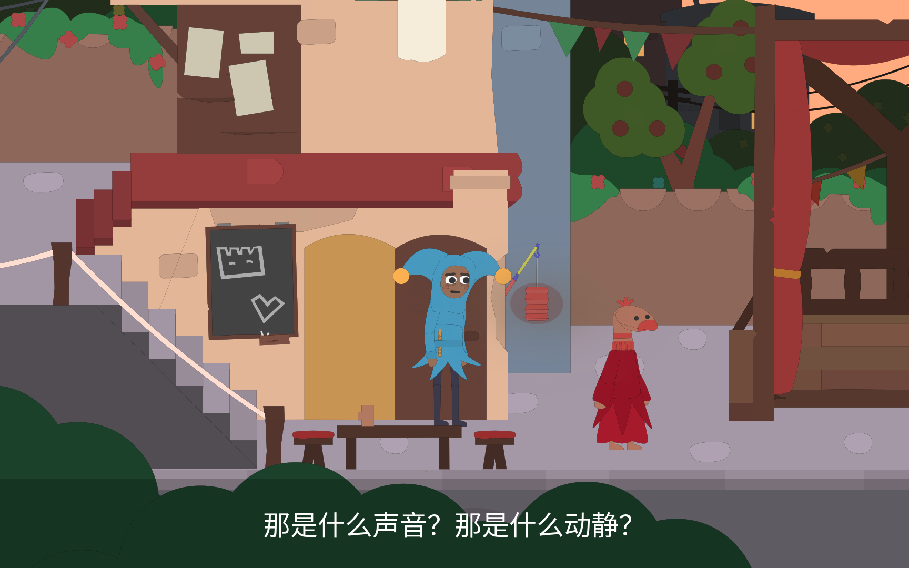
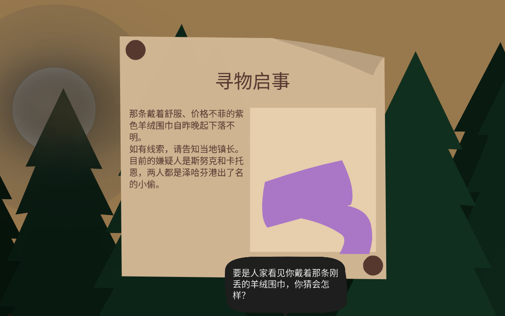

# Once Upon a Jester 简体中文汉化

**0.1.4-rc.1 公开测试版 · 2026-11-22**

[下载汉化安装包](https://github.com/newbility/Once_Upon_a_Jester_CN/releases/download/v0.1.4-rc.1/OnceUponAJester_zh-CN_0.1.4-rc.1.zip) · [SHA-256 校验文件](https://github.com/newbility/Once_Upon_a_Jester_CN/releases/download/v0.1.4-rc.1/OnceUponAJester_zh-CN_0.1.4-rc.1.zip.sha256) · [Release 说明](https://github.com/newbility/Once_Upon_a_Jester_CN/releases/tag/v0.1.4-rc.1) · [完整使用说明](docs/使用说明.txt)

适配 **Steam Windows x64，Build 12603347，游戏文件版本 1.0.1.0**（App ID 1668190）。需要已购买并安装的原游戏；其他版本及其他汉化组合未验证。

## 内容与版本变化

已提取英文目录的 **3029 条文本**完成初译、冻结输入后的独立校对与回填。另处理 10 项图字／保存提示、33 条新增字幕分句、2 条脚本提示和花束计数入口，并为哈克的环境语音复用已有译文。含中文字体、长选项断行及招牌显示修复。

本次相对本地 0.1.3 仅补齐发布声明、更新安装包版本标识。16 个游戏补丁差分及重建游戏内容保持一致。安装包包含独立图形安装器、差分及所需组件，无需 Python、共享开发工具库或联网下载。运行要求：Windows x64、.NET Framework 4.8。

## 安装、校验与恢复

1. 退出游戏，完整解压 ZIP。可用 PowerShell `Get-FileHash .\OnceUponAJester_zh-CN_0.1.4-rc.1.zip -Algorithm SHA256` 与校验文件比对。
2. 运行 `JesterChineseInstaller.exe`，用“浏览…”选择游戏目录，或粘贴包含 `Once Upon a Jester.exe` 的目录。
3. 点击“检查状态”，确认匹配后点击“安装汉化”。
4. 启动游戏，在 **Options → Language → 第七项“简体中文”** 启用；安装不会替换玩家已有语言设置。
5. 恢复时退出游戏，使用同一安装器选择相同目录并点击“恢复原版”。

请保留完整安装包及游戏目录中的 `OnceUponAJester_zh-CN_Backup_12603347` 原版备份。安装器不操作玩家存档或 Steam 云存档。受保护目录出现访问拒绝时，可右键以管理员身份运行。升级本项目旧测试包时，建议先用旧安装器恢复原版；未承诺跨版本原位升级。Steam 更新或验证文件完整性可能移除补丁。

## 实机演示

以下为隔离测试副本中的实际 GameMaker 渲染截图，包含直接设置剧情状态与受控显示入口；它们不代表完整自然通关。

演出选项与观众字幕

港口选项与中文招牌

广播歌词字幕

告示与对白排版

## 验证范围与已知限制

已在 720p／1080p 检查代表性菜单、开场分支、演出与观众字幕、后期五表长句和选项、演出／广播／卡拉 OK 歌词、告示和招牌。新增字幕测试涵盖暂停、停止、重播、换房、同房重启及重叠语音。隔离副本的存档和设置读写已验证。

公开包通过解包后的安装、检查、重复安装、混合状态修复、篡改拒绝、失败回滚与恢复测试；图形界面的目录浏览与手动输入均已测试，安装产物经隔离后实际启动。

- **尚未完整通关，也未遍历全部自然剧情、演出种子、胜负分支或海报组合。**直接进场景测试不能替代完整流程。
- FindBody 表的自然流程可达性及重复编号 20 的分支仍未确认；121 条文本已翻译保留。越界天数护栏提示只验证了受控显示。
- 新增无字幕语音采用离线识别转录＋原文与场景核对，**未直接听校**。扬的末句及酒吧片段存在识别歧义；不完整表述保留说明。
- 原字幕个别异常歌词时码保持原样；图字盘点和动画抽帧不等于全部资源、全部帧穷举。游戏标题、开发商和发行商品牌标识保留原样。
- 未承诺兼容其他 Build、其他汉化或未知升级路径。本版本为公开测试版。

## 翻译、字体与组件

翻译底稿为游戏随包英文 CSV；初译 GPT-6 Luna（max），校对 GPT-6.1 Sol（high）。已有字幕仅翻译文本，新增语音的处理限制见上文。

新增中文字形使用 Adobe Source Han Sans SC Regular 2.005，SIL Open Font License 1.1；原有游戏字形权利属于原权利人。差分工具 xdelta3 3.2.2，Apache License 2.0；BLAKE3、XZ 等组件许可随包保留。UndertaleModTool 0.9.2.0 仅用于开发；识别工具及模型均不在玩家包中分发。[版权与致谢](docs/版权与致谢.txt)

## 版权与免责声明

1. 本补丁仅供学习与交流使用，不得用于任何商业用途，请在已购买正版游戏的前提下使用。
2. 游戏文本及资源的版权归开发者/发行商所有；中文译文沿用本项目使用约定：仅供学习与交流使用，未经另行授权不得再分发或商业使用；字体使用 Source Han Sans SC Regular（思源黑体 SC Regular）2.005，遵循 SIL Open Font License 1.1。如有侵权，请联系移除。
3. 本汉化包为非官方汉化程序，对于使用汉化包而造成的任何损失，本人不负任何责任。
4. 您肯定已经详细阅读并已理解本协议，并同意严格遵守免责声明的各条款和条件。如不同意，请勿使用。
